# JobTrail

**See what every Claude Code chat is running, live, on your Mac and on a second Mac over ssh.**

JobTrail is a small macOS app (and phone web app) that shows one live, animated map of your coding agents:

```
chat ──▶ the machine it runs on ──▶ each job ──▶ the file the job is writing
```

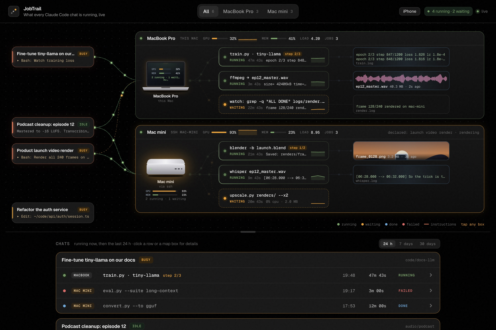

<sub>All screenshots come from the built-in demo mode (`JOBTRAIL_DEMO=1`), so the chats and jobs are made up.</sub>

- **Live flow map (top half):** each Claude Code chat is a box showing what it's doing right now. Lines run from each chat into the machines, which are drawn as a laptop or a small desktop Mac with their live GPU, memory and job counts. More lines run from the machines to each job and on to the file it is writing. Moving dots show work flowing: green for running jobs, amber for queued ones, blue for files being written.
- **Real items, not icons:** output boxes show the actual image, a frame of the video, or the real audio waveform. Job boxes show their latest log line.
- **Tap anything** for a floating card: the live log, command, processes, CPU graph, and everything the job made. Audio and video play right in the card.
- **Job list (bottom half):** every job grouped by chat, with 24 h, 7 day and 30 day history. Drag the bar between the halves to resize them.
- **Always recording:** a small background server starts at login, so jobs are recorded even while the window is closed.
- **On your phone:** click **iPhone** in the app, scan the QR code, then Add to Home Screen. It works over [Tailscale](https://tailscale.com), which encrypts the connection. Access from any other device needs a private key.
- Free, local, no accounts, no telemetry. Bun + TypeScript server, plain HTML/JS front end, tiny Swift window.

## Screenshots

### The flow map

Each chat (left) draws a line into the machine running its work: the laptop shows live GPU, memory and job counts on its screen, and the Mac mini's front light glows while it works. Lines then run to each job, and on to the actual file that job is writing: a training log, a real audio waveform, the latest rendered frame, a transcript.

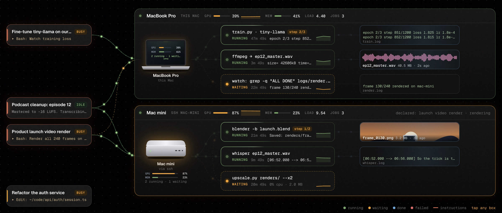

### Tap any box for details

| A job | A file it is writing (playable) |
|---|---|
| 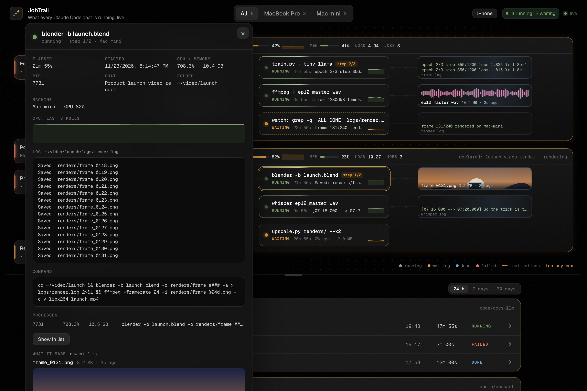 | 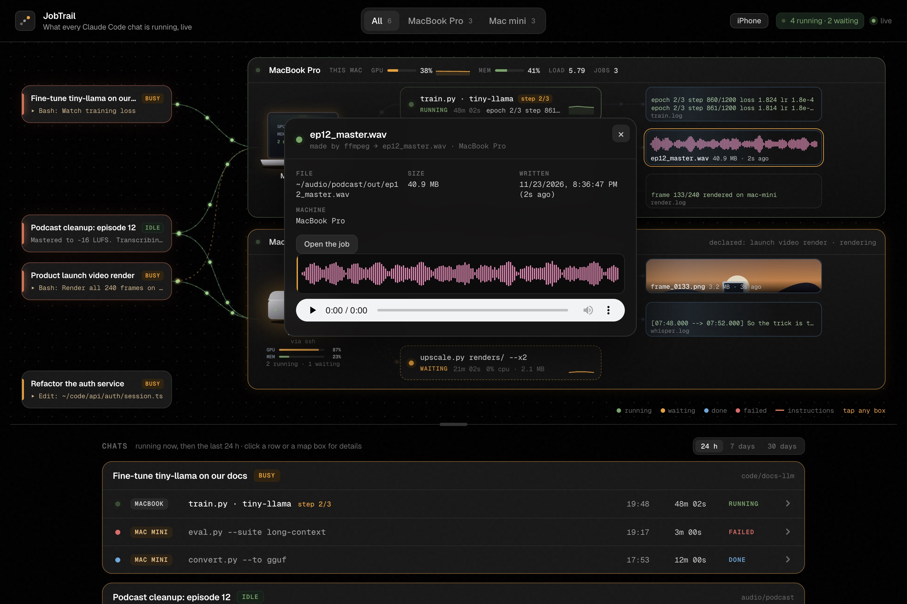 |
| **A rendered frame** | **A chat: what it is doing and its jobs** |
| 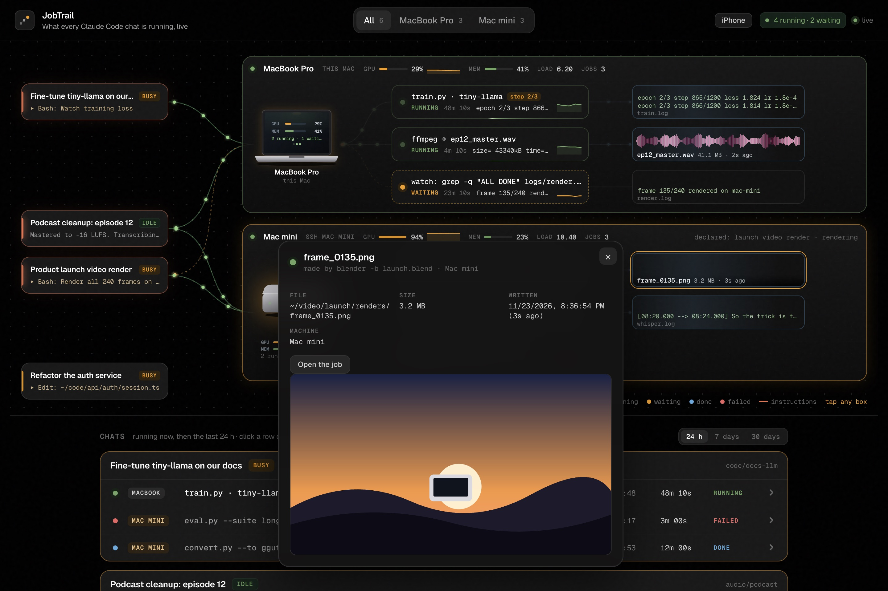 | 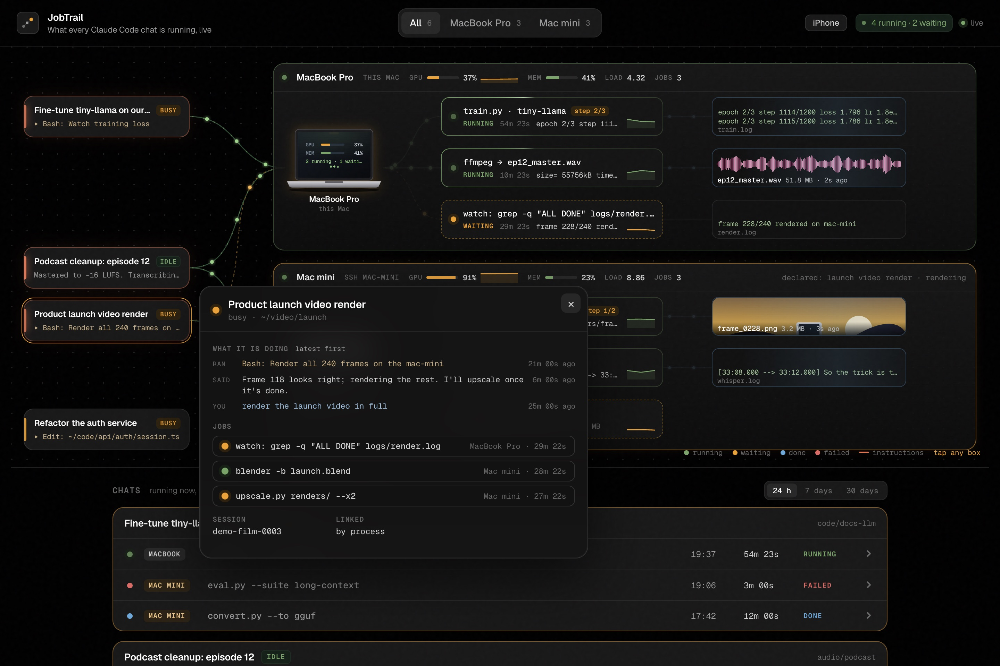 |
| **A machine** | **The job list with an expanded row** |
| 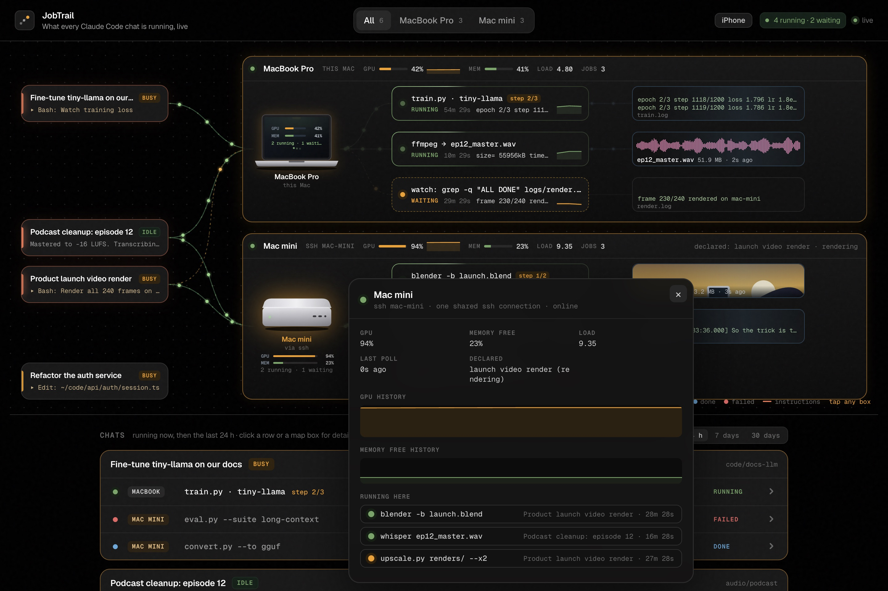 | 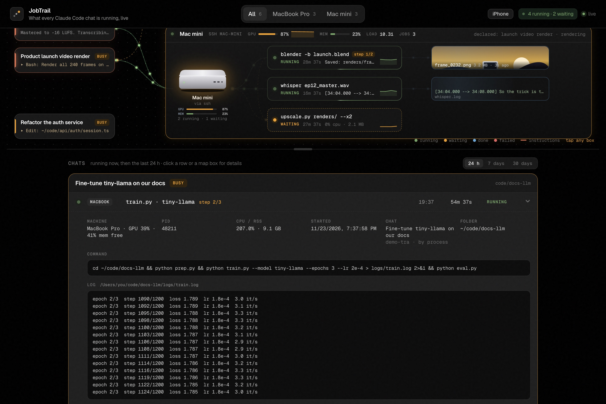 |

### History

Every job is kept for 30 days. Switch the list between 24 h, 7 days and 30 days; failed jobs show in red.

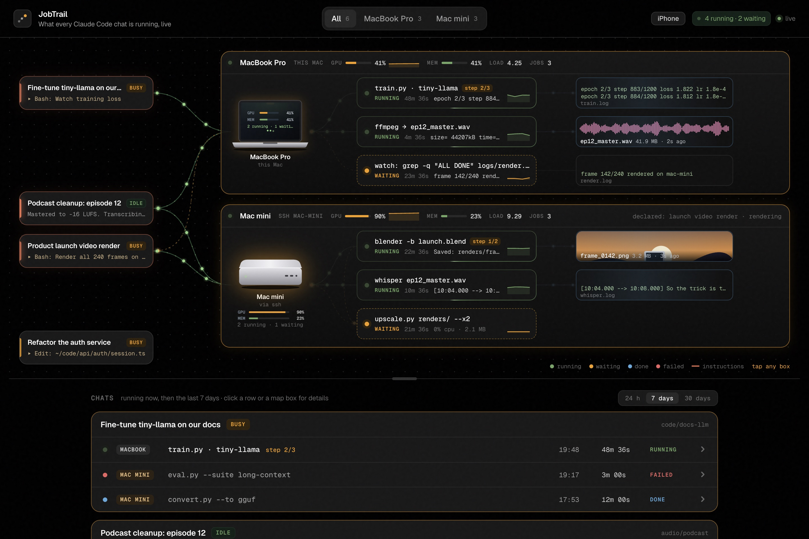

### On your phone

Click **iPhone** in the Mac app and scan the code. The link travels only over Tailscale, which encrypts it. In the screenshot the key is fake.

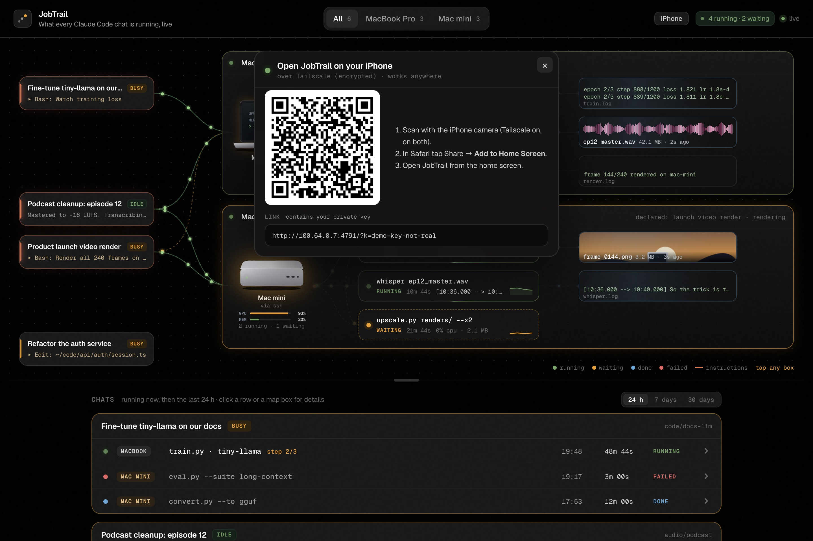

On a phone the map stacks vertically, details open as a bottom sheet, and a bottom bar jumps to the Map, the Jobs list, what's Running, your Macs, or refreshes the page.

| Map | Running | A job | A file | Macs |
|---|---|---|---|---|
| 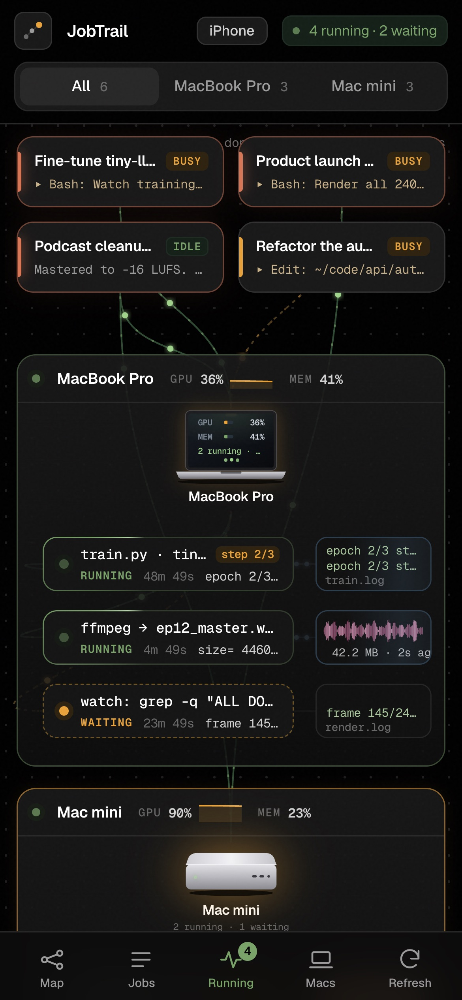 | 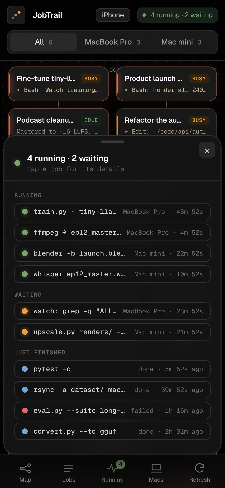 | 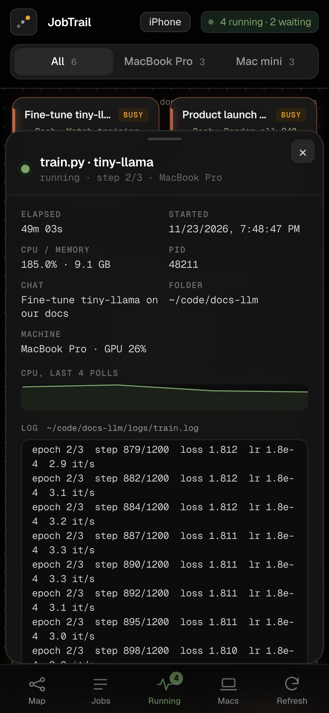 | 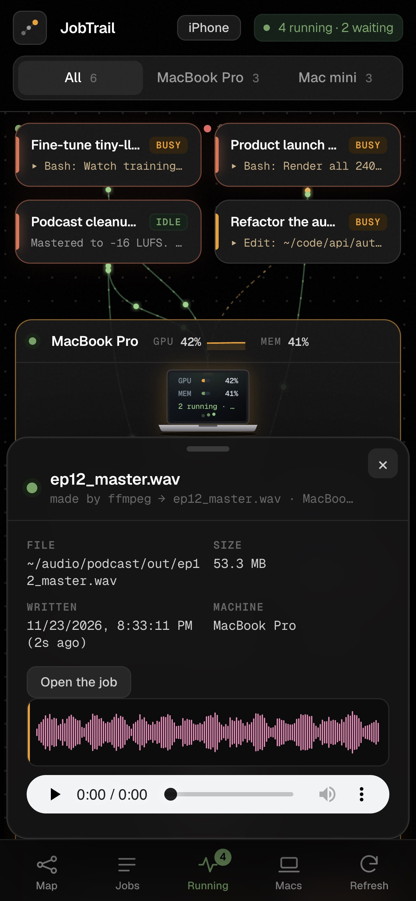 | 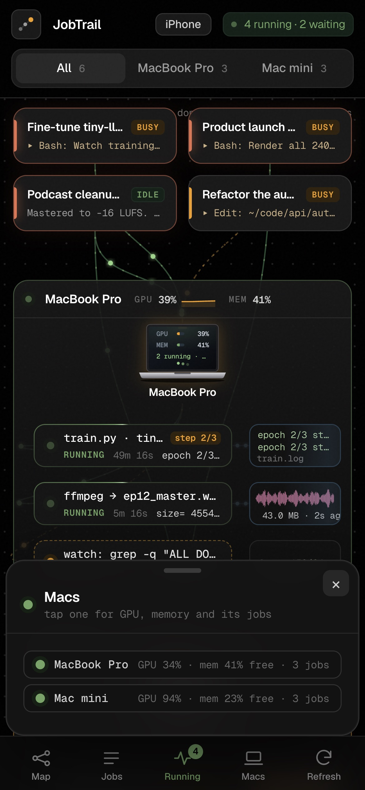 |

## Try the demo (no setup)

```bash
JOBTRAIL_DEMO=1 bun server.ts
```

Then open http://127.0.0.1:4791. Made-up chats train a model, master a podcast and render a video across two Macs, and everything moves and updates like the real thing.

## Install

Needs macOS 13+, [Bun](https://bun.sh) and the Xcode command-line tools (`xcode-select --install`).

```bash
git clone https://github.com/prabhuSub/jobtrail.git
```

```bash
cd jobtrail && bun build.ts
```

That builds `~/Applications/JobTrail.app`, starts the recorder and adds two login items (`~/Library/LaunchAgents/local.jobtrail.*.plist`). Use `bun build.ts --no-login` to skip the login items. Then open JobTrail from `~/Applications`.

To try it without building the app, run `bun server.ts` and open http://127.0.0.1:4791.

## Configure (optional)

Copy `config.example.json` to `~/.jobtrail/config.json`:

```json
{
  "local":  { "name": "MacBook Pro", "device": "laptop" },
  "remote": { "host": "my-mac-mini", "name": "Mac mini", "device": "desktop" },
  "progressFile": null
}
```

- `local`: what to call this Mac and how to draw it (`laptop` or `desktop`). By default it uses the computer name, and draws a laptop if the Mac has a battery.
- `remote`: a second Mac, given as an ssh host alias that works with key-based login (`ssh my-mac-mini` must work without a password). Leave it out to watch only this Mac. JobTrail polls it lightly over one shared ssh connection: one `ps` every 2.5 s while the window is open, every 5 s otherwise.
- `progressFile`: optional JSON with `{ "machines": [{ "name", "job", "state" }] }`. If set, each machine shows what you *declared* should be running next to what is actually observed.

You can also use the environment variables `JOBTRAIL_REMOTE`, `JOBTRAIL_REMOTE_NAME`, `JOBTRAIL_LOCAL_NAME`, `JOBTRAIL_PROGRESS` and `JOBTRAIL_PORT`.

## How it works

- **Finding jobs:** one `ps` per machine per poll. Long-running work (python, ffmpeg, Blender, bun/node, shells with `-c`, downloads…) becomes a job. Quick tool calls and system processes are ignored, and steps of a multi-step `&&` command are shown as "step 2/3".
- **Linking jobs to chats:** on this Mac, by walking up the process tree to the Claude Code process (`~/.claude/sessions/<pid>.json`). On the remote Mac, by matching the job's paths against the command that started it in `~/.claude/projects/*/*.jsonl`. Chat titles come from the Claude desktop app when available.
- **What a chat is doing:** read from the end of its transcript (last messages and tool calls).
- **Logs and outputs:** the log comes from the command's `>` redirect, or `lsof` on its stdout. Outputs are the newest files in the folders the command names. Previews are made once with `sips` or `ffmpeg` and cached in `~/.jobtrail/thumbs`. Only files JobTrail itself listed for a job can be previewed or downloaded.
- **Data:** `~/.jobtrail/` holds the history (30 days), server log, thumbnails, config and the access key (`token`).

## Phone

- **Home Screen web app (recommended):** click **iPhone** in the Mac app, scan the QR code, then Share → Add to Home Screen. Tailscale must be on, on both the Mac and the phone, and the Mac must be awake. The link is plain `http`, so it is only offered over Tailscale, which encrypts it; JobTrail never offers it over Wi-Fi.
- **Native wrapper (optional):** run `JOBTRAIL_TEAM_ID=<your Apple team id> bun build-ios.ts` with the iPhone connected. It needs Xcode and [XcodeGen](https://github.com/yonaskolb/XcodeGen). With a free Apple account the app expires after 7 days, and you can have only 3 such apps on the phone.

## Security

- The server listens on port 4791 on all network interfaces so your phone can reach it. Requests from this Mac are allowed only when addressed to `127.0.0.1` or `localhost`, and cross-site browser requests are refused (this blocks DNS-rebinding pages). Any other device needs the key in `~/.jobtrail/token`, sent as `?k=`, as a cookie, or in the `x-jobtrail-key` header.
- Anyone with the key can see your chat titles, commands and logs, and open the files JobTrail lists. Treat the QR code like a password. To revoke it, delete `~/.jobtrail/token` and restart the recorder:

```bash
launchctl kickstart -k gui/$(id -u)/local.jobtrail.server
```

## Uninstall

```bash
launchctl bootout gui/$(id -u)/local.jobtrail.server
```

```bash
rm -rf ~/Applications/JobTrail.app ~/Library/LaunchAgents/local.jobtrail.*.plist ~/.jobtrail
```

## Support JobTrail

JobTrail is free and stays free. If it saves you time, you can [sponsor it on GitHub](https://github.com/sponsors/prabhuSub). It pays for the Apple fee for a signed, double-click-to-install build and for new features.

## License

MIT. Fork it, rename it, make it your own.
